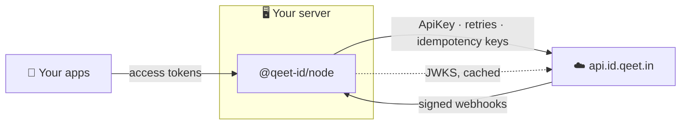

<div align="center">

# 🔐 Qeet ID for Node.js

**The server-side SDK for Qeet ID: manage an organisation's people and access, verify webhooks and access tokens, and run OAuth flows from Node.js.**

[](#-install)
[](#-typescript-and-modules)
[](#-typescript-and-modules)
[](package.json)
[](test)

[📖 Docs](#-learn-more) · [🚀 Quick start](#-quick-start) · [🧩 API](#-resources) · [📝 Changelog](CHANGELOG.md) · [🏗️ Architecture](docs/architecture/ARCHITECTURE.md)

</div>

> [!IMPORTANT]
> Use it on servers only. It authenticates with a secret API key that must never reach a browser.

## 📦 What's inside

| | |
|:--|:--|
| 🧭 **Typed client** | One `QeetID` client with 38 resource namespaces and **266 API calls**, each checked against the server's OpenAPI documents. Every request, response and error code is typed |
| 🚨 **Typed errors** | A `QeetIDError` hierarchy: one class per HTTP status, `SessionRevokedError`, `OAuthError`, `NetworkError`, `TimeoutError`. Each carries a stable `code` and the `requestId` |
| 🔁 **Safe retries** | Exponential backoff with jitter and `Retry-After`, only for requests that can't act twice. Idempotency keys sent automatically on the nine creates the API makes idempotent |
| 📄 **Pagination** | `for await` walks every item across pages; whole lists come as `{ data, truncated }` |
| 🪝 **Webhooks** | Timestamped HMAC-SHA256 verification, constant-time, two secrets during a rotation, a five-minute replay window, typed events |
| 🔑 **Access tokens** | Local ES256 verification against the issuer's signing keys, with a required issuer and audience |
| 🤝 **OAuth** | Client credentials (with `expires_in`), authorization code, refresh, token exchange, device and CIBA grants, introspection, revocation, a token guard |
| 🪶 **Lean** | No runtime dependencies (`fetch`, Web Crypto and `node:crypto` only), ES module and CommonJS builds, one file per module for tree shaking |

## 🔗 How it fits



## 📥 Install

Node.js 22.12 or later; tested on 22, 24 and 26.

```sh
npm install @qeet-id/node
# or: bun add @qeet-id/node · pnpm add @qeet-id/node · yarn add @qeet-id/node
```

## 🚀 Quick start

Create an API key in the Qeet ID console and keep it in a secret store.

```ts
import { QeetID } from "@qeet-id/node";

const qeetId = new QeetID({ apiKey: process.env.QEET_ID_API_KEY });
const tenantId = process.env.QEET_ID_TENANT_ID!;

const user = await qeetId.users.create({
  tenant_id: tenantId,
  email: "meera@brightleaffoods.in",
  display_name: "Meera Iyer",
});

await qeetId.roles.assign(tenantId, user.id, financeRoleId);

const allowed = await qeetId.permissions.check({ user_id: user.id, tenant_id: tenantId, permission: "invoice.approve" });
```

Create one client per process and share it: it is safe for concurrent use.

## ⚙️ Configuration

```ts
const qeetId = new QeetID({
  apiKey: process.env.QEET_ID_API_KEY,
  timeoutMs: 30_000,
  maxRetries: 2,
  appInfo: { name: "brightleaf-onboarding", version: "1.4.0" },
  logger: console,
});
```

| Option | Default | |
|:--|:--|:--|
| `apiKey` | none | Sent as `Authorization: ApiKey <key>`. Every management call needs it; the OAuth token endpoints, directory sign-in and credential verification work without it |
| `baseUrl` | `https://api.id.qeet.in` | Must be `https`; plain `http` only for `localhost` and `*.localhost` |
| `timeoutMs` | `30000` | Each attempt's limit, response body included |
| `maxRetries` | `2` | Retries after a transient failure, for retry-safe requests only; `0` turns them off |
| `headers` | `{}` | Sent on every request; can't replace `Authorization`, `Accept`, `Content-Type`, `User-Agent` or `Idempotency-Key` |
| `appInfo` | none | `{ name, version?, url? }`, put in front of the User-Agent |
| `logger` | none | Any object with `debug`, `info`, `warn`, `error` (`console` fits) |
| `fetch` | global `fetch` | For a proxy, custom TLS or tests |

Every method takes an options object last, overriding the client for that call:

```ts
await qeetId.users.get(userId, { timeoutMs: 5_000, maxRetries: 0, signal: AbortSignal.timeout(8_000) });
```

## 🧭 Resources

Identifiers come first, then the request body, then options. Request and response objects keep the API's
field names (`display_name`, `created_at`).

| Area | Namespaces |
|:--|:--|
| 👥 **Identity** | `tenants` (the organisation) · `domains` · `users` · `groups` · `invitations` · `branding` |
| 🛡️ **Access** | `roles` · `permissions` · `relationships` (ReBAC tuples) · `decisions` (OpenID AuthZEN) · `authPolicies` · `securityPolicies` · `ipRules` · `threatDetection` (bots, risk, anomalies) |
| 🌐 **Federation** | `oauth` · `applications` (OAuth/OpenID clients and RFC 8707 resources) · `servicePrincipals` · `samlConnections` · `samlServiceProviders` · `ldapConnections` · `scim` · `socialProviders` · `adminPortalLinks` |
| 🛠️ **Developer** | `apiKeys` · `agents` · `verifiableCredentials` · `authHooks` · `webhooks` · `secrets` · `tokenVault` |
| 📊 **Operations** | `auditLogs` · `analytics` · `billing` · `gdpr` · `emailTemplates` · `retention` · `logSinks` · `rateLimits` |

```ts
const page = await qeetId.auditLogs.list(tenantId, { action: "user.deleted", from: "2026-11-01T00:00:00Z" });
await qeetId.webhooks.update(tenantId, webhookId, { events: ["user.created", "user.deleted"] });
const { secret } = await qeetId.webhooks.rotateSecret(tenantId, webhookId);
const { data: secrets, truncated } = await qeetId.secrets.list(tenantId);
```

The SDK covers the calls an API key may make. A person's own account (their sessions, factors, passkeys,
email changes) is theirs to manage through the hosted pages. What isn't wrapped yet is listed in
[docs/FUTURE.md](docs/FUTURE.md).

## 🚨 Errors

Every failure is thrown. Branch on the class or on `code`, never on `message`.

| Class | When | Worth reading |
|:--|:--|:--|
| `BadRequestError` | 400 | `code`, `detail` |
| `AuthenticationError` | 401 | `code` |
| ↳ `SessionRevokedError` | 401 `auth.session_revoked` | sign in again; never retried |
| `PermissionDeniedError` | 403 | `code` |
| `NotFoundError` | 404 | |
| `ConflictError` | 409 | `code`, such as `idempotency.outcome_unknown` |
| `ValidationError` | 422 | `fields`: each field's `code` and `message` |
| `RateLimitError` | 429 | `retryAfterSeconds` |
| `InternalServerError` | 5xx | `requestId` |
| ↳ `ServiceUnavailableError` | 503 | `retryAfterSeconds` |
| `OAuthError` | an OAuth token endpoint refused | `code` is the RFC 6749 `error`, such as `invalid_grant` |
| `NetworkError` · `TimeoutError` | no response, or none in time | `cause` |
| `WebhookVerificationError` | a delivery failed verification | `code`, such as `signature_mismatch` |
| `TokenVerificationError` | an access token failed verification | `code`, such as `token_expired` |

All of them extend `QeetIDError`; the API ones extend `ApiError`, which also has `status`, `requestId`
(quote it to support), `metadata`, `retryable` and `headers`.

```ts
import { ConflictError, RateLimitError, ValidationError } from "@qeet-id/node";

try {
  await qeetId.users.create({ tenant_id: tenantId, email });
} catch (error) {
  if (error instanceof ValidationError) {
    for (const field of error.fields) console.log(field.field, field.code, field.message);
  } else if (error instanceof ConflictError && error.code === "user.domain_managed_elsewhere") {
    // another organisation manages that email domain
  } else if (error instanceof RateLimitError) {
    console.log(`retry in ${error.retryAfterSeconds} s, request ${error.requestId}`);
  } else {
    throw error;
  }
}
```

A mistake in your own arguments (an empty id, a malformed idempotency key) is a `TypeError` or `RangeError`.
A cancelled call rejects with the signal's reason. `instanceof` works even when both the CommonJS and the ES
module build of this package are loaded in one process.

## 🔁 Retries & timeouts

| | |
|:--|:--|
| ✅ **Retried** | `GET` and `DELETE`; POSTs that change nothing (permission and relationship checks, AuthZEN evaluations, previews, introspection); requests carrying an `Idempotency-Key` |
| ⚡ **After** | no response, a timeout, `408`, `429`, `500`, `502`, `503`, `504`, `409 idempotency.in_progress` |
| ⛔ **Never** | `PUT`, `PATCH` and other POSTs; OAuth grants (single-use); directory sign-in (counts toward the lockout); `401 auth.session_revoked`, whatever the server's `retryable` hint says |
| ⏱️ **Waits** | the server's `Retry-After` up to 60 s (a longer one is thrown as is), otherwise 0.5 s doubling to 8 s with jitter |

Each attempt has its own `timeoutMs`. An `AbortSignal` bounds the whole call, retries included:

```ts
await qeetId.users.get(userId, { signal: AbortSignal.timeout(10_000) });
```

### 🔂 Idempotency

`users.create`, `groups.create`, `invitations.create`, `servicePrincipals.create`, `apiKeys.create`,
`agents.create`, `webhooks.create`, `billing.checkout` and `billing.payInvoice` always send an
`Idempotency-Key`: one generated per call, so the SDK's own retries never create twice. Pass your own to make
retries across calls, deployments or processes safe too:

```ts
await qeetId.users.create(
  { tenant_id: tenantId, email: "meera@brightleaffoods.in" },
  { idempotencyKey: `onboarding-${employee.id}` }, // 1 to 255 printable ASCII characters
);
```

The API keeps the answer for 24 hours. The same key with another body is refused (`422
idempotency.key_reused`); `409 idempotency.outcome_unknown` means the first request was interrupted: check
whether it took effect before trying again with a new key.

## 📄 Pagination

Paged lists (users, audit log, consent grants, SCIM users and groups, anomalies, decisions, webhook
deliveries, relationship objects) return a `PagePromise`: iterate it for every item, or await it for one page.

```ts
for await (const user of qeetId.users.list({ status: "active", limit: 100 })) {
  console.log(user.email);
}

const page = await qeetId.users.list({ limit: 50 });
page.data;                                  // this page
if (page.hasNextPage()) await page.getNextPage();
for await (const p of page.iterPages()) console.log(p.data.length);
```

Other lists come whole as `{ data, truncated }`; `truncated` is `true` when the API capped the list.

## 🪝 Webhooks

Each delivery is a signed POST whose body is an event:

```json
{ "id": "…", "type": "user.created", "tenant_id": "…", "occurred_at": "2026-11-05T09:30:00Z", "data": { … } }
```

`constructWebhookEvent` checks `X-Qeet-Signature` (`sha256=` and the HMAC-SHA256 of `X-Qeet-Timestamp`, `.`
and the raw body) in constant time, refuses a delivery signed more than five minutes from now, and returns
the typed event. Always pass the **raw** body: a parsed and re-serialised one won't match.

**Express**

```ts
import express from "express";
import { constructWebhookEvent, WebhookVerificationError } from "@qeet-id/node";

app.post("/webhooks/qeet-id", express.raw({ type: "application/json" }), async (req, res) => {
  let event;
  try {
    event = constructWebhookEvent(req.body, req.headers, process.env.QEET_ID_WEBHOOK_SECRET!);
  } catch (error) {
    if (error instanceof WebhookVerificationError) return res.status(400).send(error.code);
    throw error;
  }
  if (await alreadyHandled(event.id)) return res.sendStatus(204); // deliveries can repeat
  if (event.type === "user.deleted") await removeLocalData(event.data);
  res.sendStatus(204);
});
```

**Next.js route handler, or any Fetch API server**

```ts
export async function POST(request: Request) {
  const event = constructWebhookEvent(await request.text(), request.headers, process.env.QEET_ID_WEBHOOK_SECRET!);
  // …
  return new Response(null, { status: 204 });
}
```

**node:http** — see [examples/webhook-receiver.ts](examples/webhook-receiver.ts).

| | |
|:--|:--|
| 🔄 **Rotating the secret** | `webhooks.rotateSecret()` returns a new secret; for 24 hours deliveries carry both signatures. Pass both meanwhile: `constructWebhookEvent(body, headers, [newSecret, oldSecret])` |
| 🧾 **Duplicates** | an event's `id` is the same in every delivery of it, retries included |
| 🆕 **Unknown events** | `event.type` may be newer than this SDK; ignore what you don't handle. `WEBHOOK_EVENT_TYPES` lists those this version knows |
| 🧪 **Testing** | `signWebhookPayload(body, secret)` signs a body the way Qeet ID does |
| ⚠️ **`X-Qeet-Event`** | isn't signed: read `event.type` instead |

## 🔑 Verifying access tokens

To accept Qeet ID access tokens in your own API, verify them locally against the issuer's signing keys:

```ts
import { createTokenVerifierFromDiscovery, TokenVerificationError } from "@qeet-id/node";

const verifier = await createTokenVerifierFromDiscovery({ audience: "https://api.brightleaffoods.in" });

const claims = await verifier.verify(bearerToken); // throws TokenVerificationError
claims.sub; claims.tenant_id; claims.scope;
```

Or configure it directly with `new TokenVerifier({ issuer, audience, jwksUrl })`. Both `issuer` and `audience`
are required. The verifier accepts ES256 only, needs a known `kid`, checks `iss`, `aud`, `exp`, `nbf` and `iat`
with 30 seconds of clock tolerance (`clockToleranceSeconds`), caches the keys for five minutes, and refetches
them for an unknown `kid` at most every 30 seconds.

A token verified offline stays valid until it expires, even if its session was revoked. Where revocation must
take effect at once, introspect instead:

```ts
const guard = qeetId.oauth.createTokenGuard({
  audience: "https://mcp.brightleaffoods.in",
  client_id: process.env.MCP_CLIENT_ID!,
  client_secret: process.env.MCP_CLIENT_SECRET!,
});
const claims = await guard.verify(bearerToken, ["files:read"]); // AuthenticationError or PermissionDeniedError
```

## 🤝 OAuth

```ts
// Machine-to-machine: a service principal's token (POST /v1/oauth/token).
const token = await qeetId.oauth.clientCredentialsGrant({ client_id, client_secret });
token.access_token; token.expires_in; token.expires_at;

// The other grants (POST /v1/oauth/token-code).
await qeetId.oauth.authorizationCodeGrant({ client_id, client_secret, code, redirect_uri, code_verifier });
await qeetId.oauth.refreshTokenGrant({ client_id, client_secret, refresh_token });
await qeetId.oauth.tokenExchangeGrant({ client_id, client_secret, subject_token, actor_token, scope });
await qeetId.oauth.deviceCodeGrant({ client_id, device_code });
await qeetId.oauth.cibaGrant({ client_id, client_secret, auth_req_id });

await qeetId.oauth.introspect(accessToken, { client_id, client_secret });
await qeetId.oauth.revoke(refreshToken, { client_id, client_secret });
```

The token endpoints' errors are thrown as `OAuthError`, with `code` set to the RFC 6749 `error`:
`invalid_request`, `invalid_client` (status 401), `invalid_grant`, `unauthorized_client`,
`unsupported_grant_type`, `invalid_scope`, `invalid_target`, and while polling `authorization_pending`,
`slow_down`, `access_denied` and `expired_token`. Grants are never retried. Client credentials travel in the
form body and are never logged. A token cache for machine-to-machine calls is in
[examples/machine-to-machine.ts](examples/machine-to-machine.ts).

## 🗂️ Directory sign-in

`ldapConnections.authenticate` signs a person in with their directory password. The result is tokens, or a
second-factor challenge:

```ts
const result = await qeetId.ldapConnections.authenticate(connectionId, { username, password });
if (result.type === "mfa_challenge") {
  return askForSecondFactor(result.challenge.mfa_token, result.challenge.factors);
}
startSession(result.tokens);
```

## 📝 Logging

Pass a `logger` to see each request, response and retry. Messages carry the method, path, attempt, status,
duration and request id; never the API key, client secrets, query strings, headers or bodies.

## 🧩 TypeScript and modules

ES module and CommonJS builds with matching declarations: `import` and `require` both work. Types are exported
for every request, response and error code:

```ts
import type { User, UserListParams, WebhookEvent, OAuthErrorCode } from "@qeet-id/node";
```

## 🔨 Building

```sh
bun install
bun run verify   # typecheck, Biome, tests, build, publint and Are the Types Wrong
```

Every command is in [CONTRIBUTING.md](CONTRIBUTING.md).

## 📚 Learn more

| | |
|:--|:--|
| 🧪 [Examples](examples) | Webhook receiver, protecting an API, machine-to-machine tokens, managing users |
| 🏗️ [Architecture](docs/architecture/ARCHITECTURE.md) | How a request travels from a method to the API and back |
| 🧠 [Design decisions](docs/design-decisions) | Namespaces, errors, wire names, retries, the dual package |
| 📐 [Engineering practices](docs/engineering-practices.md) | The practices this SDK follows, with their sources |
| 🗺️ [What's not covered yet](docs/FUTURE.md) | API areas still to wrap, and those left out on purpose |
| 🤝 [Contributing](CONTRIBUTING.md) | Setting up, conventions, tests |
| 📝 [Changelog](CHANGELOG.md) | What's in each version |
| 🔒 [Security](SECURITY.md) | Reporting a vulnerability to security@qeet.in |

## 📜 Licence

[MIT](LICENSE) © Qeet Group.

---

<div align="center">

Made with 🧡 by Qeet Group · [⬆️ Back to top](#-qeet-id-for-nodejs)

</div>
